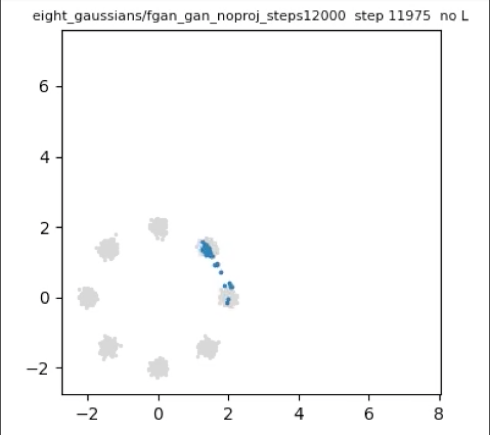
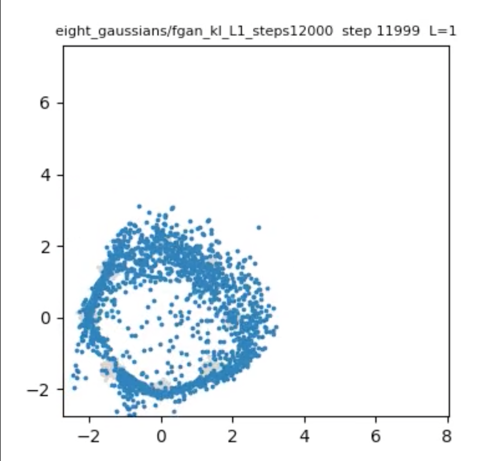
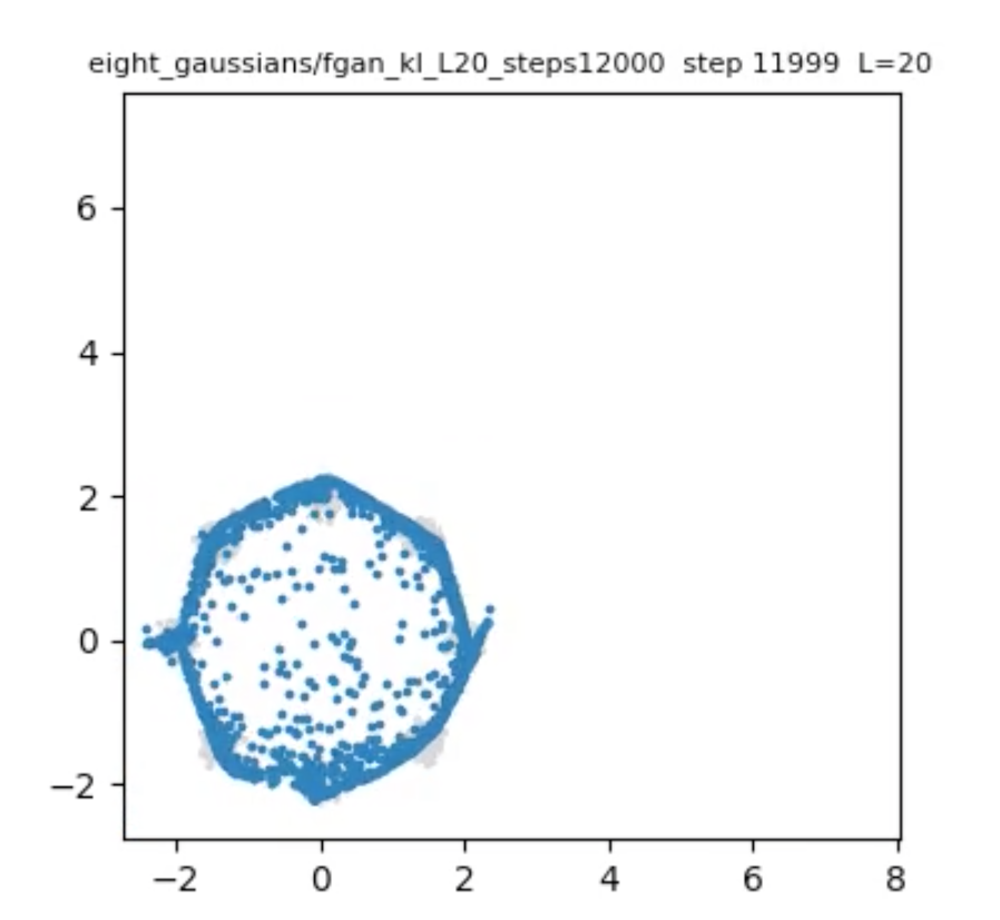
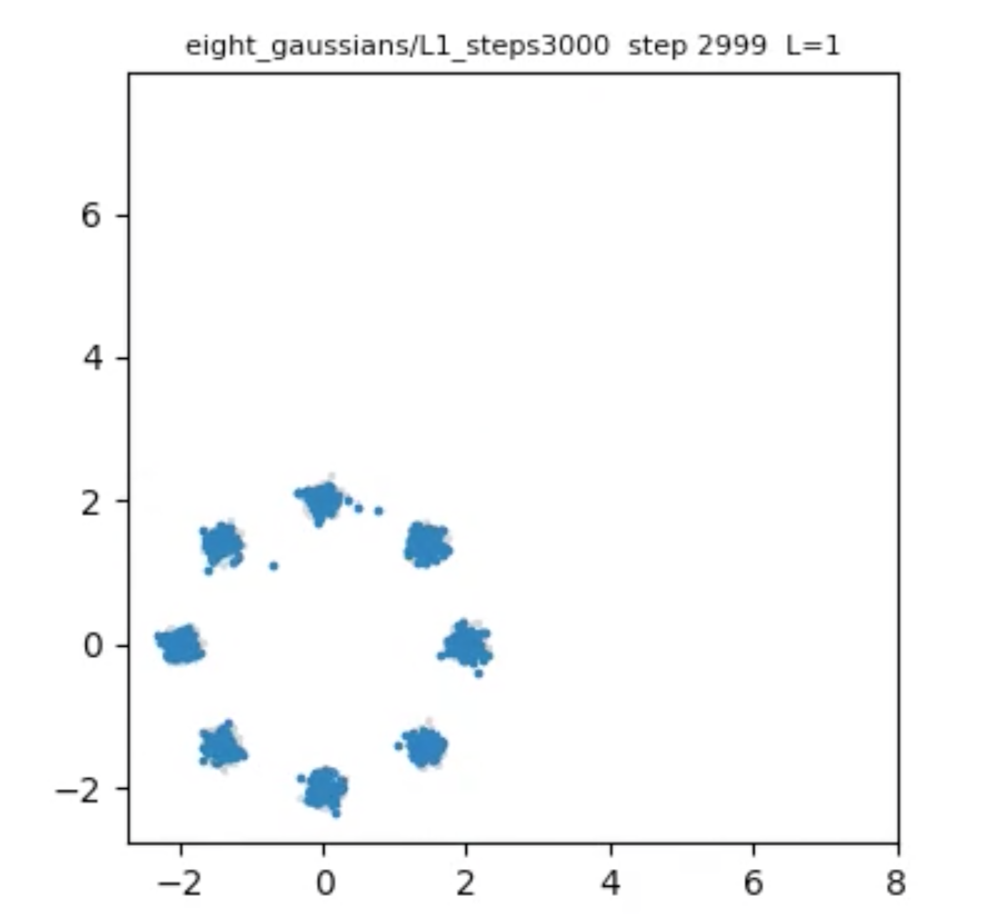
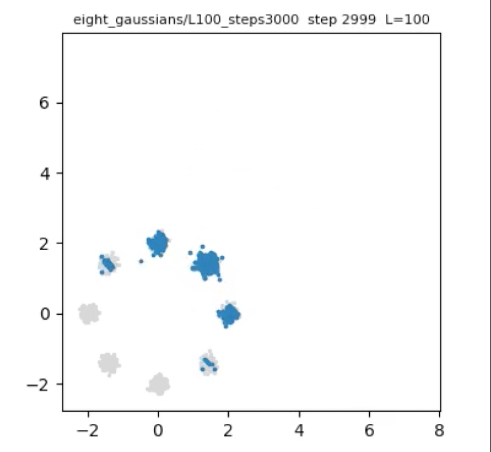

# Lipschigz Reularized Generative Modeling

This repository consists of an investigation onto the role of (KL,Lip-L)-divergences (see [^1]) in generative modeling. It contains an implementation of an f-GAN (see [^2]) and a GPA, a generative partcle algorithm presented in [^3], and inicial experiments with these two models to try to address the following questions:

- Can GPA be an alternative to GANs and $f$-GANs that provides more stable training and more effective learning?
- What role can the Lipschitz regularization parameter L play in algorithms such as $f$-GANs and GPA? 

The hypothesis is the following: during training of an algorithm like GAN or GPA, smaller values of L are beneficial in early stages of training, where it is important to explore large regions of the ambient space to avoid mode collapse (Wasserstein-1 behavior), and bigger values of $L$ are better for the refinement of the distribution (KL behavior). Under the supervision of Professor Panagiota Birmpa, from Heriot-Watt Universty, Edinburgh, I have been investigating the theoretical background on this proposal, namely the asymptotic behavior of the discriminator of the (KL,Lip-L)-divergences. Some preliminary results on this topci can be found in: 

**Preprint (draft, not peer reviewed):** [Asymptotic behavior of reuglarized discriminators in generative modeling](Asymptotic_behavior_of_regularized_discriminators_in_generative_modeling_and-beyond.pdf), version of November 2026.

<!-- Put your best result here, for example a GIF of GPA on eight_gaussians. -->
<!--  -->

## Contents

1. [Installation](#installation)
2. [Quickstart](#quickstart)
3. [Datasets](#datasets)
4. [Running GPA](#running-gpa)
5. [Running the f-GAN](#running-the-f-gan)
6. [Command-line reference](#command-line-reference)
7. [Output files](#output-files)
8. [Experiments and results](#experiments-and-results)
9. [Measuring computational cost](#measuring-computational-cost)
10. [Repository structure](#repository-structure)
11. [Known limitations](#known-limitations)

## Installation

You need [uv](https://docs.astral.sh/uv/) and git.

```bash
git clone clone https://github.com/eduardonrpinto/Lipschitz-Regularized-Generative-Modeling.git
cd  Lipschitz-Regularized-Generative-Modeling
uv sync
```

`uv sync` installs the exact versions in `uv.lock`, so everyone gets the same environment.

Check that the install works:

```bash
uv run python -c "from genmodel.gpa import gpa; from genmodel.fgan import train_fgan; print('ok')"
```

**Tested with:** _(fill in: OS, CPU, Python version, torch version)_.

**Intel Macs:** recent PyTorch releases no longer ship Intel macOS builds. If installation fails, pin an older release: `uv add "torch==2.2.2" "numpy<2"`.

**Videos:** MP4 output uses the ffmpeg binary bundled with the `imageio-ffmpeg` package, so you do not need to install ffmpeg yourself.

## Quickstart

A short GPA run on the moons dataset, with a video:

```bash
uv run python scripts/run_all.py --datasets eight_gaussians --L-values 1 2 5 --L-steps 50 50 50
```

This prints the progress, the training time and the final distance to the data, and saves the video to `assets/eight_gaussians/L1-2-5_steps100-50-50.mp4`. Open it with `open assets/eight_gaussians/L1-2-5_steps100-50-50.mp4` (macOS) or any video player.

A short f-GAN run on the same data:

```bash
uv run python scripts/run_all.py --model fgan --datasets eight_gaussians --divergence gan \
    --L-values 1 5 --L-steps 1500 1500
```

## Datasets

All current datasets are 2D and need no download. Each one is a function in `src/genmodel/datasets.py`, registered under a name.

| Name | Description |
|---|---|
| `moons` | Two interlocking half circles (scikit-learn) |
| `circles` | Two concentric rings (scikit-learn) |
| `spiral` | A noisy spiral arm |
| `eight_gaussians` | Eight small Gaussians on a ring of radius 2 |
| `gaussian_shift` | A unit Gaussian centered at (2, 0) |

Choose one or more with `--datasets`:

```bash
uv run python scripts/run_all.py --datasets spiral eight_gaussians --L-values 1 2 5 --L-steps 50 50 50
```

**Adding your own dataset:** add a function to `datasets.py`. It must take `n` and return a float32 tensor of shape `(n, 2)`.

```python
@register("my_dataset")
def my_dataset(n, some_param=1.0):
    return ...   # tensor of shape (n, 2)
```

It then appears in `--datasets` automatically. 

## Running GPA

GPA is the default model. You define the **L schedule** with two lists of the same length: the value of `L` in each stage, and the number of outer steps spent in that stage.

```bash
uv run python scripts/run_all.py --datasets eight_gaussians \
    --L-values 1 2 5 --L-steps 50 50 50
```

This uses L=1 for 50 steps, L=2 for 50 steps and L=5 for 50 steps. The step size in each stage is `dt = dt0 / L`, where `dt0` (default 0.25) is the step size at `L = 1`. The largest possible movement per step, `dt × L`, is therefore `dt0` in every stage.

A constant `L` is a single stage:

```bash
uv run python scripts/run_all.py --datasets eight_gaussians --L-values 5 --L-steps 200
```

## Running the f-GAN

To run the $f$-GAN one of the following loss must be chosen:

- Original GAN loss: `--divergence gan --no-projection`
- KL: `-- divergence kl --no-projection`
- (KL,Lip_L): `--divergence KL --L (value of L)`

When using (KL,Lip_L)-divergence, one can also choose adaptive L. Here are some exmaples:

```bash
#Gan loss
uv run python scripts/run_all.py --model fgan --datasets eight_gaussians --divergence gan \
    --no-projection --n-steps 3000
```

```bash
#Constant L
uv run python scripts/run_all.py --model fgan --datasets eight_gaussians --divergence kl \
    --L 5 --n-steps 3000
```

```bash
#With an L schedule: one stage = L and a number of generator steps
uv run python scripts/run_all.py --model fgan --datasets eight_gaussians --divergence kl \
    --L-values 1 20 --L-steps 1500 1500
```

> **Notes:**
>
> - `--divergence` is `kl` or `gan`. Add more in the `DIVERGENCES` dictionary in `src/genmodel/fgan.py`.
> - One f-GAN step is `k_disc` discriminator updates followed by one generator update, so $f$-GANs need many more steps than GPA (thousands, not hundreds).
> - If you give `--L-values` and `--L-steps`, `--n-steps` and `--L` are ignored.
> - With `--no-projection`, `L` has no effect. Prefer `--divergence gan` in that case, since KL can overflow without a constraint.

## Command-line reference

Run `uv run python scripts/run_all.py --help` for the full list.

| Flag | Applies to | Meaning | Default |
|---|---|---|---|
| `--model` | both | `gpa` or `fgan` | `gpa` |
| `--datasets` | both | One or more dataset names | all |
| `--L-values` | both | `L` of each stage | none |
| `--L-steps` | both | Steps in each stage | none |
| `--solver` | GPA | `euler` or `heun` | `euler` |
| `--dt0` | GPA | Step size at `L = 1`; `dt = dt0 / L` | 0.25 |
| `--divergence` | f-GAN | `kl` or `gan` | `kl` |
| `--n-steps` | f-GAN | Generator steps when no schedule is given | 200 |
| `--L` | f-GAN | Constant `L` when no schedule is given | 1.0 |
| `--no-projection` | f-GAN | Unconstrained discriminator | off |
| `--prior-mean` | both | Mean of the Gaussian prior, one number per dimension | 0 |
| `--M` | both | Number of particles | 1000 |
| `--seed` | both | Random seed | 0 |
| `--frame-every` | both | One video frame every this many steps | 25 |
| `--print-every` | both | Print the divergence estimate every this many steps | 25 |
| `--no-video` | both | Skip the video and only print and save numbers | off |

If your copy of `run_all.py` also has `--lr-g` and `--lr-d`, they set the f-GAN learning rates.

## Output files

- `assets/<dataset>/<run name>.mp4`: video of the particles (blue) moving onto samples of the data (gray). The title shows the step and the current `L`.
- `assets/results.csv`: one row per run with the dataset, model, schedule, solver, sliced Wasserstein distance (`sw`), the `floor`, and the training time.
- The terminal shows the **divergence estimate** every `--print-every` steps. It tracks the stage of training and is noisy, so look at the trend.

## Experiments and results

All experiments use the `eight_gaussians` dataset. For the first five experiments, the prio distribution is a gaussian with mean (4,4) and standard deviation 2. As for the last two experiments, it is a gaussian with mean (8,8) and standard deviation 2. Below we provide the commands to reproduce the experiments and comments on the results.

<table>
  <tr>
    <td align="center" width="33%">
      <br>
      <sub><b>Figure 1.</b> GAN, 12000 steps.</sub>
    </td>
    <td align="center" width="33%">
      <br>
      <sub><b>Figure 2.</b> (KL,Lip-1)-GAN, 12000 steps.</sub>
    </td>
    <td align="center" width="33%">
      <br>
      <sub><b>Figure 3.</b> (KL,Lip-20)-GAN, 12000 steps.</sub>
    </td>
  </tr>
  <tr>
    <td align="center" width="33%">
      <br>
      <sub><b>Figure 4.</b> GPA, L=1, 3000 steps.</sub>
    </td>
    <td align="center" width="33%">
      <br>
      <sub><b>Figure 5.</b> GPA, L=100, 3000 steps.</sub>
    </td>
  </tr>
</table>

**Figure 1** 

```bash
 uv run python scripts/run_all.py --model fgan --datasets eight_gaussians --divergence gan  --prior-mean 4 4 --no-projection -n-steps 12000
```

**Figure 2** 

```bash
uv run python scripts/run_all.py --model fgan --datasets eight_gaussians --divergence kl  --prior-mean 4 4 --L-values 1 --L-steps 12000
```
We observe that the f-GAN with (KL,Lip-1)-divergence learns the whole data landscape better than the conventional GAN, but still fails to capture the eight distinct gaussians

**Figure 3** 

```bash
uv run python scripts/run_all.py --model fgan --datasets eight_gaussians --divergence kl  --prior-mean 4 4 --L-values 20 --L-steps 12000
```
With (KL,Lip-20)-GAN we observe improvements in comparison to the (KL,Lip-20)-GAN with the same number of training steps, altough far from a satisfatory learning of the distributions

**Figure 4** 

```bash
uv run python scripts/run_all.py --datasets eight_gaussians --L-values 1 --L-steps 3000 --prior-mean 4 4
```
GPA with L=1 achieves a much finer learning of the target distribution and also more stable training. This could have to do with the fact that GPA only has to train a neural network for learning the discriminator and not two neural networks like GAN. 

**Figure 5** 

```bash
uv run python scripts/run_all.py --datasets eight_gaussians --L-values 100 --L-steps 3000 --prior-mean 4 4
```
GPA with L=100 collapses onto the modes which are nearest from the prior distribution, suggesting that L=100 provides a too strong discrimination signal which makes all the particles collapse immediately onto the closest mode instead of exploring the space. We recall that with L=100, (KL,Lip_100) is closer to KL, which is known for its tendency for mode collpase. 


## Repository structure

```
my-genmodel/
├── pyproject.toml, uv.lock       # dependencies (exact versions in the lockfile)
├── README.md
├── preprint.pdf
├── src/genmodel/
│   ├── gpa.py                    # GPA algorithm, Lipschitz critic, L schedule, ODE solvers
│   ├── fgan.py                   # f-GAN: generator, discriminator, divergences, training loop
│   ├── datasets.py               # dataset registry
│   ├── experiments.py            # run_experiment: runs either model on a dataset
│   ├── metrics.py                # sliced Wasserstein distance
│   └── viz.py                    # particle videos
├── scripts/
│   └── run_all.py                # command-line entry point
├── assets/                       # generated videos and results.csv (ignored by git)
└── docs/images/                  # figures shown in this README
```

## Reference


[^1]: Birrell et al., *$(f,Γ)$-Divergences: Interpolating between f-Divergences and Integral Probability Metrics*, https://arxiv.org/abs/2011.05953
[^2]: S. Nowozin et al., *f-GAN*, https://arxiv.org/abs/1606.00709
[^3]: H. Gu et al., *Lipschitz-regularized gradient flows and generative particle algorithms for high-dimensional scarce data*, https://arxiv.org/abs/2210.17230

